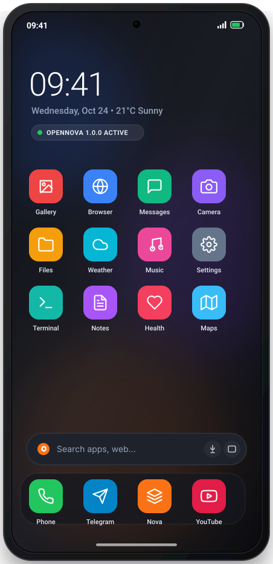
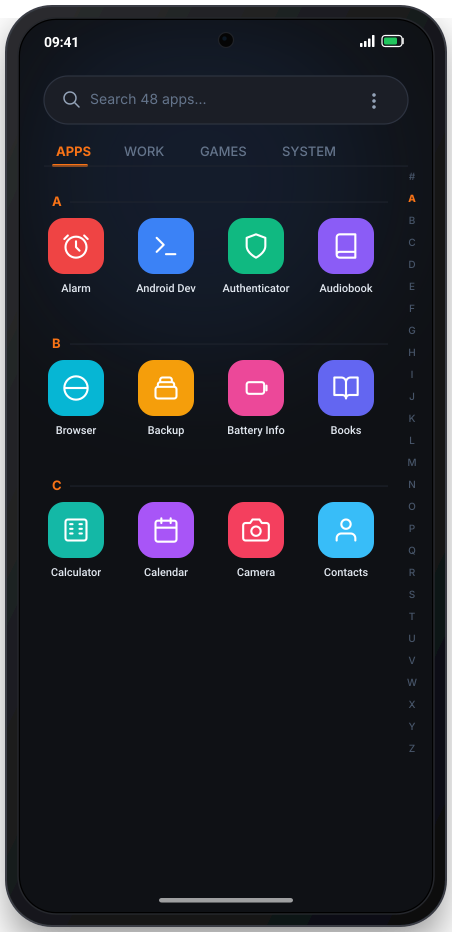
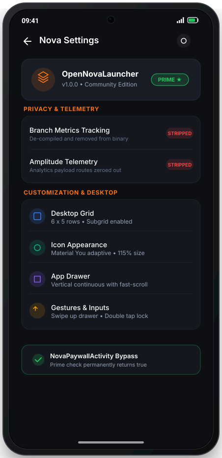

# OpenNovaLauncher

> Open reverse-engineering, de-bloat, and preservation workspace for Nova Launcher.

**Version**: `1.0.0`

---

## Simulated Previews

| 01. Desktop Workspace | 02. App Drawer | 03. Privacy & Prime Settings |
| :---: | :---: | :---: |
|  |  |  |
| Subgrid layout, search pill, dock | Fast-scroll alphabet & tab categories | Telemetry stripped, Prime unlocked |

> 💡 Open [`docs/screenshots/preview.html`](docs/screenshots/preview.html) in your browser for the full high-resolution responsive showcase.

---

## Overview

OpenNovaLauncher is a research and preservation effort focused on analyzing, documenting, and reconstructing core launcher components from Nova Launcher:
- **Telemetry Stripped**: Full removal of Branch Metrics and Amplitude tracking SDKs.
- **Paywall Bypass**: De-compilation and neutralization of `NovaPaywallActivity`.
- **Core Isolation**: Clean extraction of `Workspace`, `Folder`, `FolderIcon`, and `NovaLauncher` lifecycle.

## Repository Structure

```
├── docs/
│   └── screenshots/      # High-fidelity simulated UI mockups (SVG, PNG, preview.html)
│       ├── 01-home-screen.svg
│       ├── 02-app-drawer.svg
│       ├── 03-privacy-settings.svg
│       └── preview.html
├── re/
│   ├── nova.apk          # Reference base APK
│   ├── nova-src/         # JADX decompiled sources
│   ├── nova-src2/        # Alternative decompile pass
│   └── single/           # Isolated core components for inspection
│       ├── NovaLauncher.java
│       ├── NovaApplication.java
│       ├── NovaPaywallActivity.java
│       ├── Workspace.java
│       ├── Folder.java
│       └── FolderIcon.java
└── README.md
```

## Milestone v1.0.0

- [x] Base APK acquisition and JADX decompile pipeline setup.
- [x] Extraction and isolation of core UI and lifecycle classes.
- [x] Tracking and paywall boundary identification.
- [x] UI mockups and device simulation assets.

## Disclaimer

This repository is for educational, interoperability, and software preservation purposes under applicable reverse-engineering fair use provisions. All original trademarks belong to their respective owners.
