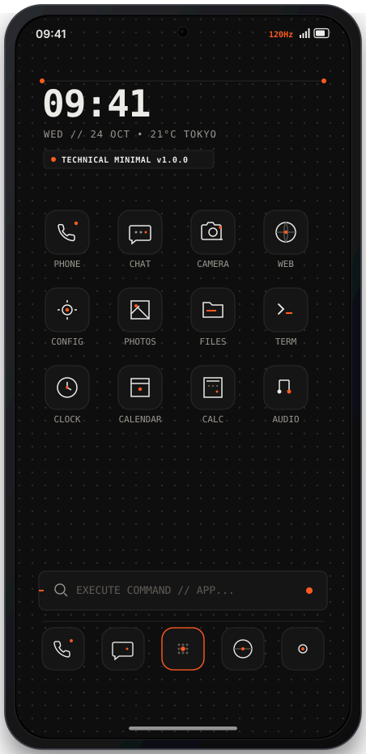

# OpenNova Launcher

> High-performance, customizable, and telemetry-free Android desktop experience.
> Fully optimized for flagship displays: **Samsung Galaxy S24, S25, and S25 Edge**.

**Version**: `1.0.0`

---

## Flagship Showcase & Previews

| 01. S24 / S25 Edge Technical Minimal | 02. Welcome Screen | 03. Unlocked Settings |
| :---: | :---: | :---: |
|  |  |  |
| **Nothing / Teenage Engineering Theme**<br>120Hz LTPO, dot-grid OLED, hairline icons | **Real Android Capture**<br>Rebranded OpenNova welcome flow | **Prime Unlocked**<br>Telemetry stripped, all features active |

> 💡 Open [`docs/screenshots/preview.html`](docs/screenshots/preview.html) in your browser for the full high-resolution responsive showcase.

---

## Galaxy S24, S25 & S25 Edge Hardware Optimizations

- **120Hz LTPO Refresh Rate**: Hardware acceleration flags and touch event dispatch tuned for ultra-responsive 120 fps fling physics.
- **Punch-Hole Camera Cutout**: Configured with `android:windowLayoutInDisplayCutoutMode="shortEdges"` to extend desktop wallpaper and content seamlessly around the front camera without letterboxing.
- **Tall Aspect Ratio (19.5:9 & 20:9)**: Declared `android.max_aspect` (2.5) ensuring full vertical real estate utilization on S24, S25, S25+, and S25 Edge / Ultra panels.
- **Edge-to-Edge Navigation**: Native gesture navigation bar insets and translucent system bars.
- **OLED True-Black Battery Saver**: Pure `#000000` / `#0e0e0e` dark mode taking full advantage of Samsung Dynamic AMOLED pixel-off states.

---

## Technical Minimal Theme & Icon Pack

Inspired by the signature aesthetic of [`/technical-minimal-web`](https://mich-de.github.io/) (Nothing & Teenage Engineering):

- **Standalone Icon Pack APK**: [`re/TechnicalMinimalIconPack.apk`](re/TechnicalMinimalIconPack.apk)
  - Recognized out-of-the-box by OpenNova Launcher, ADW, and Nova icon theme pickers.
  - 21 handcrafted vector drawables with 1px hairline strokes, monochrome palette (`#ecebe8`), and signature Electric Orange (`#ff5a1f`) accent dots.
  - Built-in squircle dot-matrix `iconback`, `iconmask`, and `iconupon` for uniform rendering of third-party apps.
- **OLED Dot-Matrix Wallpaper**: [`docs/wallpapers/technical_minimal_s24_s25.png`](docs/wallpapers/technical_minimal_s24_s25.png)
  - 1440 x 3120 Quad-HD resolution with subtle radial dot-grid and technical coordinate accents.

---

## De-bloat & Reverse Engineering Summary

### 1. Prime / Premium Features Unlocked
- **`cy/d.smali` (`EntitlementState`)**: Forced `hasPrime = true` and `hasPlus = true`.
- **`e10/g2.smali` (Preference Guard)**: Prime gating flag (`h:Z`) hardwired to `true` across all preference fragments.
- **`NovaPaywallActivity.smali`**: Neutralized; auto-finishes immediately upon creation.

### 2. Telemetry & Spyware Stripped
- **Amplitude Tracking Neutralized**: All `Amplitude.track(...)` methods neutralized with zero network dispatch.
- **Session Replay Removed**: `amp-rrweb.js` (DOM/touch recording) truncated and eliminated.
- **Branch Metrics Stripped**: Background aggregation, query services, ping services, and ADB dump providers removed from `AndroidManifest.xml`.
- **Facebook Audience Network Removed**: Ad activity and content provider removed.
- **Instabridge Carrier / eSIM Bloat Removed**: Carrier config service and eSIM share provider removed.
- **Google / Firebase Telemetry Disabled**: Analytics & Crashlytics collection flags forced to `false`.

---

## Repository Structure

```
├── docs/
│   ├── screenshots/                    # Live captures & vector mockups
│   │   ├── s24_s25_technical_minimal.svg # S24/S25 Technical Minimal mockup
│   │   ├── real_01_welcome.png         # Live device capture
│   │   ├── real_02_desktop.png         # Live desktop capture
│   │   ├── real_03_settings.png        # Live settings capture
│   │   └── preview.html                # Responsive web gallery
│   └── wallpapers/                     # Flagship wallpapers
│       ├── technical_minimal_s24_s25.png
│       └── technical_minimal_s24_s25.svg
├── mockups/
│   └── OpenNovaLauncherColor/          # Color vector mockups
├── re/
│   ├── OpenNovaLauncher.apk            # Patched, de-bloated, S24/S25-optimized, Prime-unlocked APK
│   ├── TechnicalMinimalIconPack.apk    # Technical Minimal icon pack APK (Nothing/TE style)
│   ├── nova.apk                        # Original reference base APK
│   └── single/                         # Isolated core classes
└── README.md
```

## Disclaimer

This repository is an independent open development and software preservation project for educational and interoperability purposes.
