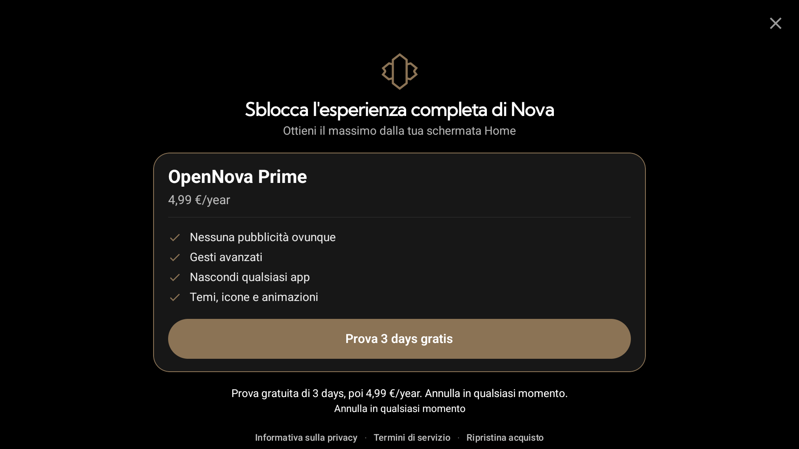
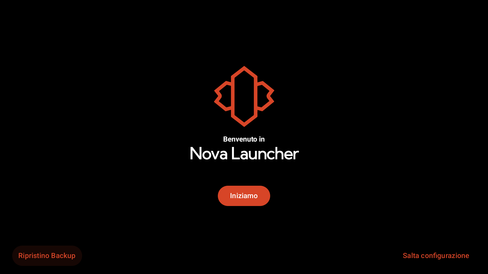
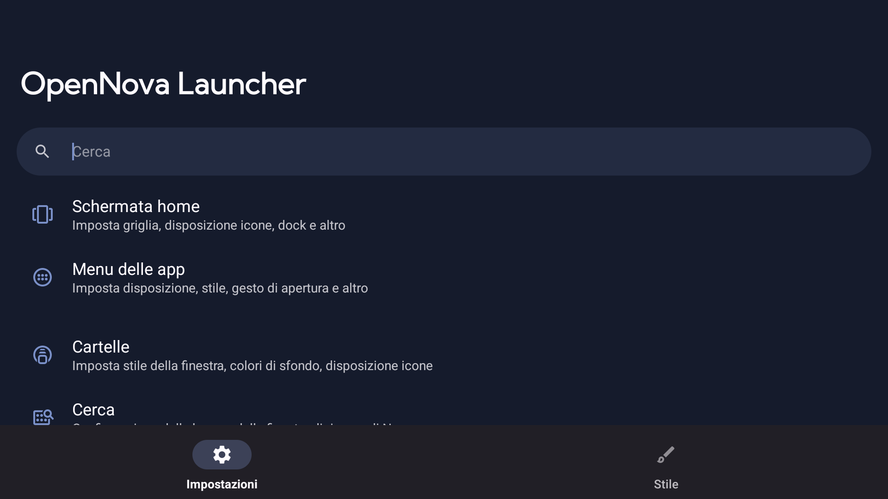

# OpenNova Launcher

> High-performance, customizable, and telemetry-free Android desktop experience.

**Version**: `1.0.0`

---

## Real Device Captures

Screenshots captured from the running patched APK (`OpenNova Launcher v1.0.0`):

| 01. First Run Setup | 02. Welcome Screen | 03. Settings & Unlocked Features |
| :---: | :---: | :---: |
|  |  |  |
| Rebranded Welcome dialog | Onboarding flow | Clean launcher settings |

> 🎨 Looking for stylized vector mockups? See [`mockups/OpenNovaLauncherColor/`](mockups/OpenNovaLauncherColor/) and [`docs/screenshots/preview.html`](docs/screenshots/preview.html).

---

## De-bloat & Reverse Engineering Changelog

### 1. Prime / Premium Features Unlocked
- **EntitlementState Neutralized (`cy/d.smali`)**: Constructor forced to permanently instantiate with `hasPrime = true` and `hasPlus = true`.
- **Preference Guard Unlocked (`e10/g2.smali`)**: Prime gating flag (`h:Z`) hardwired to `true` across all preference fragments (Desktop, Drawer, Look & Feel, Gestures).
- **Paywall Auto-Bypass (`NovaPaywallActivity.smali`)**: `onCreate` immediately calls `finish()` and dismisses.

### 2. Telemetry & Spyware Stripped
- **Amplitude Tracking Neutralized**: All `Amplitude.track(...)` methods neutralized with zero network dispatch.
- **Session Replay Removed**: `amp-rrweb.js` (DOM/touch recording) truncated and eliminated.
- **Branch Metrics Stripped**: Background aggregation, query services, ping services, and ADB dump providers removed from `AndroidManifest.xml`.
- **Facebook Audience Network Removed**: Ad activity and content provider removed.
- **Instabridge Carrier / eSIM Bloat Removed**: Carrier config service and eSIM share provider removed.
- **Google / Firebase Telemetry Disabled**: Analytics & Crashlytics collection flags forced to `false`.

---

## Repository Structure

```
├── docs/
│   └── screenshots/               # Real Android captures & preview gallery
│       ├── real_01_welcome.png    # Live capture: "Benvenuto in OpenNova Launcher"
│       ├── real_01_onboarding.png # Live capture: FirstRun setup
│       ├── real_02_desktop.png    # Live capture: Desktop workspace
│       └── real_03_settings.png   # Live capture: SettingsActivity
├── mockups/
│   └── OpenNovaLauncherColor/     # Stylized vector device mockups (SVG / PNG)
├── re/
│   ├── OpenNovaLauncher.apk       # Patched, de-bloated, Prime-unlocked, aligned & signed APK
│   ├── nova.apk                   # Original reference base APK
│   ├── nova-src/                  # Decompiled sources
│   └── single/                    # Isolated core classes
└── README.md
```

## Disclaimer

This repository is an independent open development and software preservation project for educational and interoperability purposes.
